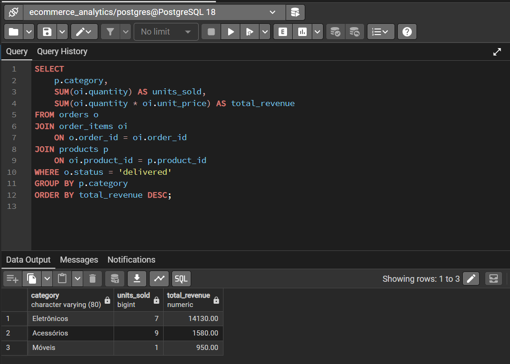
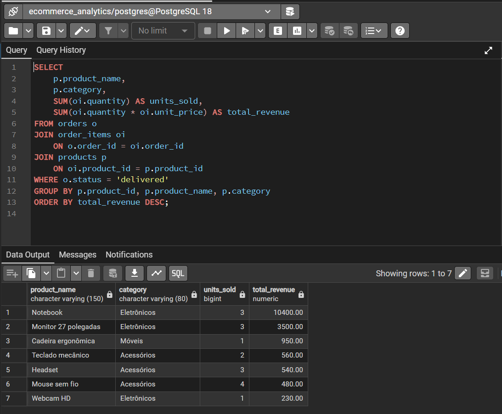

# E-commerce Analytics with SQL

## About the Project

This project explores e-commerce sales data using PostgreSQL to generate business insights and demonstrate SQL skills for data analysis.

The database simulates an online store, including customers, products, orders, and order items. The project focuses on sales performance, customer behavior, and data quality.

## Business Questions

- What is the total revenue generated by delivered orders?
- Which product categories generate the most revenue?
- Which products perform best in terms of revenue and units sold?
- Which customers make repeat purchases?
- How does revenue change over time?
- Are there potential data quality issues in the dataset?

## Technologies

- PostgreSQL
- SQL
- pgAdmin 4
- Visual Studio Code
- Git and GitHub (for version control and project publishing)

## Database Schema

The database contains four related tables:

| Table | Description |
|---|---|
| `customers` | Customer information |
| `products` | Product catalog and prices |
| `orders` | Customer orders and their statuses |
| `order_items` | Products, quantities, and prices associated with each order |

### Relationships

- One customer can place multiple orders.
- One order can contain multiple order items.
- One product can appear in multiple order items.

## Project Structure

```text
ecommerce-sql-analytics/
├── README.md
├── sql/
│   ├── 01_create_tables.sql
│   ├── 02_insert_data.sql
│   ├── 03_business_analysis.sql
│   └── 04_data_quality.sql
└── results/
```

## SQL Analysis

The project includes:

- Business metrics using aggregate functions such as `SUM`, `COUNT`, and `AVG`.
- Multi-table queries using `JOIN`.
- Revenue analysis by product category.
- Product ranking using window functions (`RANK()`).
- Monthly revenue analysis using `DATE_TRUNC`.
- Repeat customer analysis using `GROUP BY` and `HAVING`.
- Data quality checks for missing values, duplicates, invalid quantities, and inconsistent references.

## Business Rules

- Only orders with the status `delivered` are included in completed-sales revenue analysis.
- Revenue is calculated as `quantity * unit_price`.
- The `unit_price` recorded in each order item is used to preserve the price associated with the transaction.

## How to Run

1. Install PostgreSQL and pgAdmin 4.
2. Create a database named `ecommerce_analytics`.
3. Execute `sql/01_create_tables.sql`.
4. Execute `sql/02_insert_data.sql`.
5. Execute the queries in `sql/03_business_analysis.sql`.
6. Execute the checks in `sql/04_data_quality.sql`.

**Important:** Run the table creation and data insertion scripts only once on a newly created database. If the tables or sample records already exist, use a fresh database to reproduce the project from scratch.

## Dataset

The project uses fictional, manually created sample data for educational and portfolio purposes. No real customer information is included.

## Skills Demonstrated

- Relational database design
- Primary and foreign keys
- SQL joins and aggregations
- Common Table Expressions (CTEs)
- Window functions
- Business metrics and sales analysis
- Data quality validation

## Future Improvements

- Add a Python pipeline to extract and transform data.
- Automate data quality checks.
- Connect the database to Power BI.
- Create a sales performance dashboard.
- Expand the dataset to enable deeper analysis.

---

## Results





Project status: SQL scripts implemented and tested with a sample dataset.
